# Lane G UI captures still waiting on a visual call

Simulator 3.1.2 frames from `cursor/lane-g-front-end` at `a0cbb45f`, with no local patch. Pokered pin `af519899719f0754965776faac0e836a3b906e6d`. Each note is a factual difference between the Playdate frame and that source. BlueBot owns the visual call. These notes do not include a Game Boy screenshot. The reference beside each frame is the pokered draw site and its strings.

`origin/main` is still `ea32b553` ("Nest the coverage snapshot after the Hall of Fame credits draw"). That commit is an ancestor of this branch. The credits recheck waits until main moves past it. No merge was made.

Already reviewed, and left out of this set: the title, the main menu, naming, the start menu, options, nicknames, the battle command page, the battle HUD, send-out, the Hall of Fame, the credits roll, and the overworld maps. Those notes are in `lane-g-progress.md`.

Frames are `artifacts/lane-g/ui-unreviewed/`.

## Pokédex list

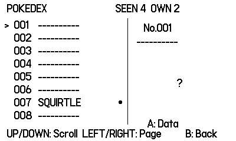

The frame draws `POKEDEX` in the system font, `SEEN 4 OWN 2`, an ASCII `>` on `001 ----------`, and a right pane `No.001` with `?`. Seen owned names (007 SQUIRTLE) carry a dot. `Source/game/pokedexState.lua` draws that `>` and the `A: Data` / `UP/DOWN: Scroll` footer.

pokered `engine/menus/pokedex.asm` labels the counts `SEEN` and `OWN` (`PokedexSeenText`, `PokedexOwnText`). `PokedexMenuItemsText` is `DATA` / `CRY` / `AREA` / `QUIT`. That four-item menu is absent from this frame.

## Pokédex entry

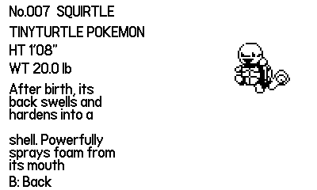

`No.007 SQUIRTLE`, `TINYTURTLE POKEMON`, `HT 1'08"`, `WT 20.0 lb`, the flavor lines, the front sprite, and `B: Back`. A on an owned row opens this page directly.

pokered reaches the same data page through the `DATA` item of `PokedexMenuItemsText` in `engine/menus/pokedex.asm`. `CRY`, `AREA`, and `QUIT` are not on this frame.

## Party list

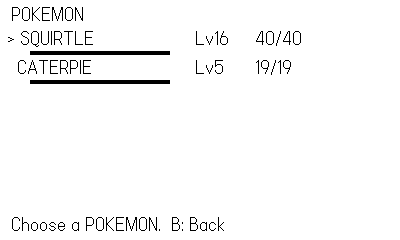

`POKEMON`, then `SQUIRTLE Lv16 40/40` and `CATERPIE Lv5 19/19` with HP bars, and `Choose a POKEMON. B: Back`. The row cursor is the ASCII `>` from the party list draw.

## Party actions

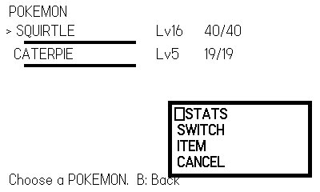

The same list, plus a box `STATS` / `SWITCH` / `ITEM` / `CANCEL`. The box cursor is `BattleMenu`'s `▶` (`Source/ui/menu.lua`). Field moves are absent on this Lv16 Squirtle. `Source/game/partyState.lua` builds those four labels.

## Party stats

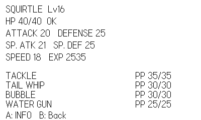

`SQUIRTLE Lv16`, `HP 40/40 OK`, `ATTACK 20 DEFENSE 25`, `SP. ATK 21 SP. DEF 25`, `SPEED 18 EXP 2535`, then `TACKLE` 35/35, `TAIL WHIP` 30/30, `BUBBLE` 30/30, `WATER GUN` 25/25.

pokered `engine/pokemon/status_screen.asm` `.StatsText` is `ATTACK`, `DEFENSE`, `SPEED`, `SPECIAL`. The two special lines are the Gen V split already recorded in `docs/validation/fidelity-ledger.md`.

## Bag

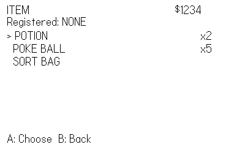

`ITEM`, `$1234`, `Registered: NONE`, `POTION x2`, `POKE BALL x5`, `SORT BAG`, `A: Choose B: Back`. `Source/game/bagState.lua` draws the `$`.

pokered prints money with the `MONEY_SIGN` tile (the yen mark), as on the trainer card in `engine/menus/start_sub_menus.asm` (`PrintBCDNumber` with `MONEY_SIGN`). The pack list has no `Registered` line and no `SORT BAG` row.

## Trainer card

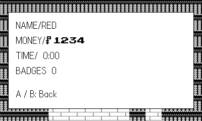

`NAME/RED`, `MONEY/` plus the yen glyph and `1234`, `TIME/ 0:00`, `BADGES 0`, `A / B: Back`. Bedroom tiles stay visible around the white panel. `Source/game/pauseState.lua` draws the badge count with `BADGES` and the money line through `GbFont.drawMoneyLine`.

pokered `StartMenu_TrainerInfo` in `engine/menus/start_sub_menus.asm` calls `DrawTrainerInfo` then `DrawBadges`. `DrawTrainerInfo` places `RedPicFront`, then `NAME/`, `MONEY/`, `TIME/` (`TrainerInfo_NameMoneyTimeText`), and prints money with `MONEY_SIGN`. This frame has the count and has no front picture and no badge tiles.

## Save

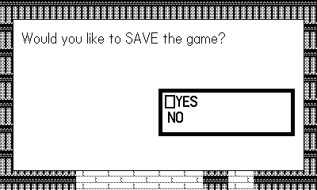

`Would you like to SAVE the game?` and a `YES` / `NO` box. The cursor is `BattleMenu`'s `▶`. A was not pressed, so nothing was written.

That question is `_WouldYouLikeToSaveText` in pokered `data/text/text_3.asm` (`Would you like to` / `SAVE the game?`). This frame is that question over the bedroom.

## Bill's PC

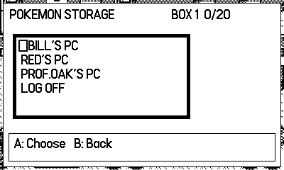

`POKEMON STORAGE`, `BOX 1 0/20`, then `BILL'S PC`, `RED'S PC`, `PROF.OAK'S PC`, `LOG OFF`. Both `EVENT_MET_BILL` and `EVENT_GOT_POKEDEX` were set, which is what `Source/game/pcState.lua` uses for those rows. The terminal is `pokered:VIRIDIAN_POKECENTER` with the player at `(13, 4)` facing up.

pokered `engine/pokemon/bills_pc.asm` uses `BILL's PC`, `'s PC` (the player name is prefixed), `PROF.OAK's PC`, `LOG OFF`, and `BOX No.`.

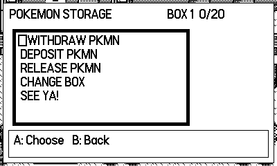

`WITHDRAW PKMN`, `DEPOSIT PKMN`, `RELEASE PKMN`, `CHANGE BOX`, `SEE YA!`.

pokered `BillsPCMenuText` in the same file is `WITHDRAW <PKMN>`, `DEPOSIT <PKMN>`, `RELEASE <PKMN>`, `CHANGE BOX`, `SEE YA!`.

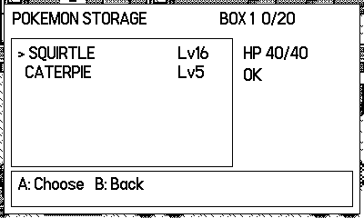

`SQUIRTLE Lv16 HP 40/40` and `CATERPIE Lv5 OK`, under the same `POKEMON STORAGE` / `BOX 1 0/20` header.

## Evolution announce

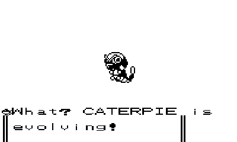

Caterpie's front on white, and the dialog `What? CATERPIE is evolving!`. The fixture granted Caterpie from level 6 to 7. That level adds no move (`bugBite` is level 15), so the announce opened with no learning prompt. The pic swap and the result line were not captured.

The line is `_IsEvolvingText` in pokered `data/text/text_3.asm`: `What? @`, the name, `is evolving!`. The animation that follows is `EvolveMon` in `engine/movie/evolution.asm`.

## Battle move list

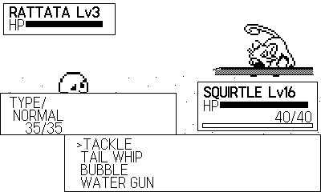

`inMoveSelect` is true on this frame. The type box reads `TYPE/` `NORMAL` and `35/35`. The move box reads `>TACKLE`, `TAIL WHIP`, `BUBBLE`, `WATER GUN`. Both HP boxes stay up: `RATTATA Lv3` and `SQUIRTLE Lv16` `40/40`. `Source/battle/battleScene.lua` `drawMoveSelect` draws the ASCII `>` and `drawMoveDetail` draws `TYPE/` and the PP.

pokered `engine/battle/core.asm` prints `TYPE/` and `<curPP>/<maxPP>` in `MoveSelectionMenu` (the `print TYPE/` comment at the type/PP block).

## Battle bag

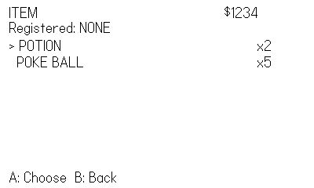

Opened from the battle `BAG` command. `ITEM`, `$1234`, `Registered: NONE`, `POTION x2`, `POKE BALL x5`. This overlay has no `SORT BAG` row. The `$` and the `Registered` line are the same field-bag draw in `Source/game/bagState.lua`.

## Battle party

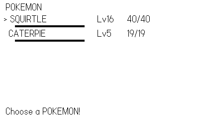

Opened from the battle `POKEMON` command. `SQUIRTLE Lv16 40/40` and `CATERPIE Lv5 19/19`, with the prompt `Choose a POKEMON!`.

## Mart, rechecked

A facing the counter does open the shop. The player has to stand on the walkable cell in front of the counter, `(4, 5)` on `kanto_viridian_mart`, facing left. That cell faces grid `(3, 5)`, whose foot tile is a mart counter (`pokered:MART:cell:0e-0f-1e-1f`, `terrain.counter` true). `KantoWorld.tryInteract` then looks one cell further and finds the clerk at `(2, 5)`. With `EVENT_OAK_GOT_PARCEL` the event is the shop. The captured menu is `artifacts/lane-g/ui-fidelity/mart-shop-after.png`: `POKE MART`, the yen figure, `Hi there! May I help you?`, and `BUY` / `SELL` / `QUIT`. The aisle frame below is the earlier stand at `(3, 7)`, which does not face the counter. There is no `lane-e-mart-counter-talk` patch.

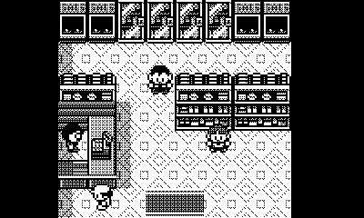

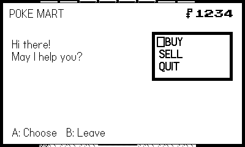

## Still not captured

The learning-move overlay and the evolution result line. The mart item list behind BUY was not shot; the greeting menu above is the screen A opens.
